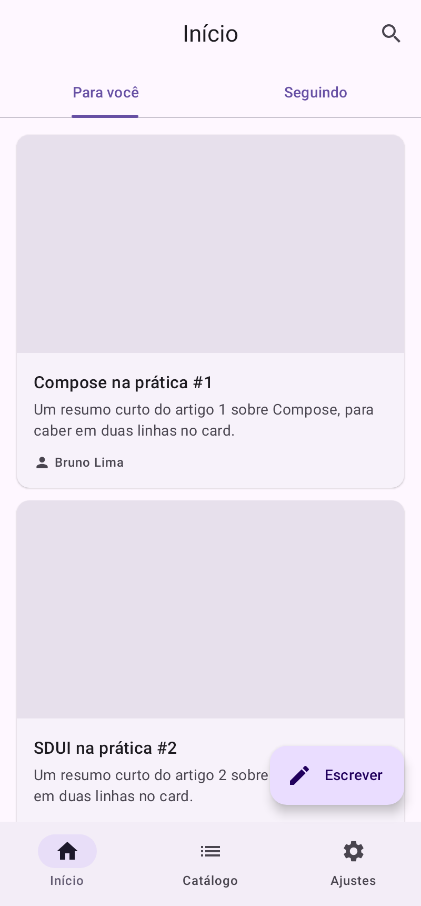
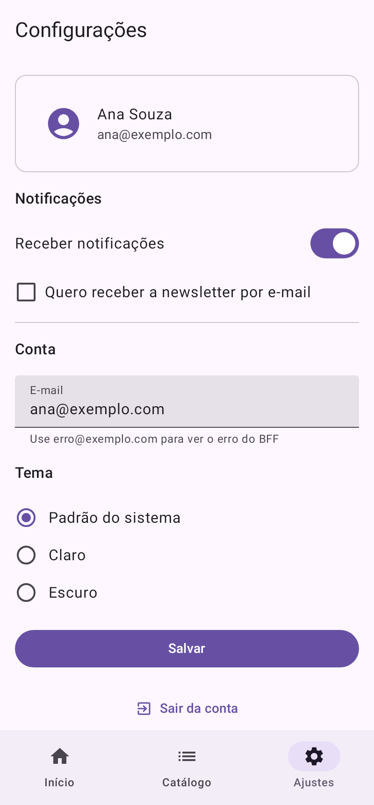
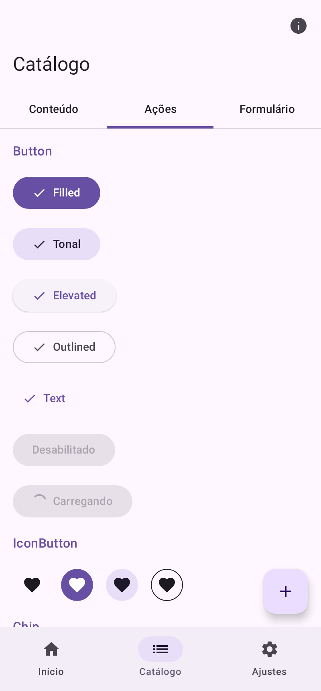
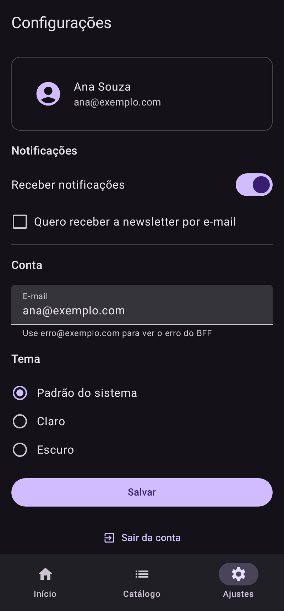

# Material SDUI

Server-Driven UI com Material 3 em Kotlin Multiplatform. O BFF descreve cada tela em JSON; os apps Android e iOS desenham essa tela com os componentes do `material3`, a partir de um código só, sem código novo por tela.

O contrato (o formato do JSON) é um só e está em Kotlin: o BFF serializa com ele e os apps desserializam com ele. A referência completa está em [`docs/CONTRACT.md`](docs/CONTRACT.md).

<p>
  
  
  
  
</p>

## Módulos

```
contract  (KMP: JVM + iOS)         os tipos do JSON, com kotlinx.serialization
   │
   ├── bff  (Kotlin/JVM, Ktor)      monta o JSON de cada tela, com um construtor por componente
   │
   └── engine  (KMP: JVM + iOS)     estado da tela, ligações, ações, carga das telas (cache + ETag)
          │
          └── renderer  (Compose Multiplatform: Android + iOS)   desenha cada componente com o material3
                 │
                 ├── androidApp   casca fina (tema + SduiApp)
                 └── iosApp       casca fina (SwiftUI + ComposeUIViewController)
```

| Módulo        | O que tem                                                                                                                                                                                                                                                                                         |
| ------------- | ------------------------------------------------------------------------------------------------------------------------------------------------------------------------------------------------------------------------------------------------------------------------------------------------- |
| `contract/`   | `ScreenResponse`, `Screen`, `Component` (26 tipos, `sealed`), `Action` (15, `sealed`), `Trigger`, `Bindable` (valor fixo ou `{ "$state": ... }`), `RequestResult` e o `SduiJson`, que já trata a compatibilidade (tipo, ação, gatilho, prop e enum desconhecidos não quebram).                  |
| `engine/`     | `ScreenController` (executa as ações, guarda camadas abertas, carregamentos e erros, valida campos, aplica as respostas do BFF), `StateStore`, as interfaces do que é da plataforma (`SduiHost`: navegação, HTTP, analytics, URL, log) e o `ScreenRepository` (pede as telas com a versão do contrato, `ETag` e cache). Não depende do Compose. |
| `renderer/`   | `SduiApp` (pilha de telas, telas nativas, erro com "tentar de novo", voltar do sistema), `SduiScreen` (um `Scaffold` com as raízes, camadas, Snackbar e carregamento de tela) e `SduiComponent` (um composable do material3 por tipo). No iOS, `SduiViewController(baseUrl, startRoute)`.                     |
| `bff/`        | Servidor Ktor: `GET /screens/{rota}` com `ETag`/`304` e checagem de versão, e as APIs de exemplo. O DSL em `bff/.../dsl` tem uma função por componente e por ação.                                                                                                                              |
| `androidApp/` | `MainActivity` com o tema (cor dinâmica) e o `SduiApp`.                                                                                                                                                                                                                                         |
| `iosApp/`     | App SwiftUI que embute o framework `SduiRenderer`. O projeto do Xcode sai do `project.yml` (XcodeGen).                                                                                                                                                                                          |

O `engine` não estava no briefing como peça separada: é a parte do renderer que não depende do Compose. Separado, ele roda e é testado na JVM, e o `renderer` fica só com o desenho.

## O BFF

Uma tela é uma função:

```kotlin
fun settingsScreen(data: SampleData) = screen(id = "settings", title = "Configurações") {
    initialState("notifications" to true, "email" to "")
    topBar { topAppBar(id = "top", title = "Configurações") }
    content {
        column(id = "content", spacing = 16, padding = Padding.all(16)) {
            switch(id = "notifications", checked = state("notifications"), label = "Receber notificações")
            textField(
                id = "email",
                value = state("email"),
                label = "E-mail",
                keyboard = KeyboardKind.Email,
                validation = listOf(required("Informe o e-mail"), email("E-mail inválido")),
            )
            button(id = "save", label = "Salvar") {
                onClick(
                    validate(
                        "email",
                        onValid = request(
                            method = RequestMethod.Post,
                            endpoint = "/api/profile",
                            body = json("email" to state("email")),
                            onSuccess = showSnackbar("Configurações salvas"),
                            onError = showSnackbar("Não deu certo. Tente de novo."),
                        ),
                    ),
                )
            }
        }
    }
}
```

As telas de exemplo ficam em [`bff/src/main/kotlin/.../screens`](bff/src/main/kotlin/com/fabianofranca/sdui/bff/screens):

- `home`: abas ligadas ao estado, feed paginado (`onLoadMore` + `append`) com puxar para atualizar, FAB que abre um BottomSheet com formulário validado;
- `article?id=…`: detalhe com parâmetro de rota, imagem, chips, `openUrl`;
- `settings`: o exemplo do briefing (estado, validação no app e no BFF, `request`, Snackbar, Dialog);
- `catalog`: todos os componentes numa tela só, para conferir o renderer nas duas plataformas.

O JSON que elas geram está em [`docs/examples/`](docs/examples).

## Como rodar

Numa máquina Linux nova (ambiente cloud, CI), `bash scripts/setup-cloud-env.sh` instala o Android SDK e o Android CLI e configura um espelho do Maven Central. Veja o [`CLAUDE.md`](CLAUDE.md) para os comandos do dia a dia.

Requisitos: JDK 17 ou mais novo. Para o Android, o Android SDK (API 37: `sdkmanager "platforms;android-37.0"`). Para o iOS, um Mac com Xcode e o [XcodeGen](https://github.com/yonaskolb/XcodeGen).

```bash
# BFF em http://localhost:8080
./gradlew :bff:run
curl localhost:8080/screens/settings

# Testes do contrato, do motor e do BFF
./gradlew :contract:jvmTest :engine:jvmTest :bff:test

# Capturas das telas de docs/examples, sem aparelho (Robolectric + Roborazzi)
# Saem em renderer/build/outputs/roborazzi/. Com espelho do Maven: -Probolectric.repo=<url>
./gradlew :renderer:testAndroidHostTest

# Os mesmos JSONs como @Preview do Compose (androidApp/src/debug), no Android Studio
# ou no terminal com o Android CLI (https://developer.android.com/cli):
android preview list androidApp
android preview render androidApp --fqn=com.fabianofranca.sdui.android.SduiPreviewsKt.HomePreview --output build/previews

# Android (emulador: o BFF fica em 10.0.2.2:8080)
./gradlew :androidApp:installDebug
./gradlew :androidApp:installDebug -Psdui.bffUrl=http://192.168.0.10:8080   # outro endereço

# iOS (simulador: o BFF fica em localhost:8080)
cd iosApp && xcodegen generate && open iosApp.xcodeproj
```

No app, o `SduiConfig` recebe o que é da plataforma:

```kotlin
SduiApp(
    SduiConfig(
        baseUrl = "https://bff.exemplo.com",
        httpClient = HttpClient { /* Auth, DefaultRequest, timeouts: fora do JSON */ },
        cache = meuCacheEmDisco,                 // padrão: em memória
        analytics = { event -> analytics.log(event) },
        nativeRoutes = mapOf<String, @Composable (NativeRoute) -> Unit>("login" to { route -> LoginScreen(route.navigator) }),
        icons = SduiIcons { name -> meusIcones[name] } orElse SduiIcons.Default,
        onExit = { finish() },
    ),
)
```

## Versões

| Peça                     | Versão                                                                      |
| ------------------------ | --------------------------------------------------------------------------- |
| Kotlin                   | 2.4.21                                                                      |
| Compose Multiplatform    | 1.12.2                                                                      |
| material3 (do CMP)       | 1.9.0 (= `androidx.compose.material3` 1.4.0; 1.10 em diante ainda é alpha) |
| material-icons-core      | 1.7.3 (a última publicada pelo CMP)                                         |
| kotlinx.serialization    | 1.12.0                                                                      |
| kotlinx.coroutines       | 1.11.0                                                                      |
| Ktor (cliente e servidor) | 3.6.1                                                                      |
| Coil                     | 3.6.3                                                                       |
| Android Gradle Plugin    | 9.5.0 (com Gradle 9.8.2); `compileSdk`/`targetSdk` 37, `minSdk` 24          |
| Alvos iOS                | `iosArm64` (aparelho) e `iosSimulatorArm64` (simulador em Mac Apple Silicon) |

Sobre a pergunta em aberto do briefing ("a versão do Compose Multiplatform e a correspondência do `material3` dele com o androidx"): o `material3` do CMP passou a ter versão própria. A estável mais recente é a 1.9.0, que corresponde ao `material3` 1.4.0 do androidx. As 1.10 a 1.13 ainda são alpha/beta.

## O que foi decidido além do briefing

O briefing deixou algumas coisas em aberto ou sem forma. A escolha feita em cada uma, todas compatíveis com o resto do contrato:

- **Navegação:** as rotas são telas do SDUI (o app pede `GET /screens/{rota}` ao BFF) ou telas nativas registradas no app (`nativeRoutes`). É a proposta do briefing.
- **Autenticação e cabeçalhos:** ficam no `HttpClient` que o app entrega, fora do JSON.
- **Formulários:** validação no app (`validation` + `validate`) e também no BFF, pelo `errors` da resposta de um `request`.
- **Resposta de `request` (`RequestResult`):** pode trazer `state`, `errors`, `append` e `action`. Sem o `append`, o `onLoadMore` não teria como acrescentar itens.
- **Ligação com `equals`:** `{ "$state": "aba", "equals": "noticias" }` vale `true`/`false`. É o mínimo para mostrar o conteúdo da aba selecionada sem um interpretador de expressões.
- **Campo sem ligação** guarda o valor no estado pela chave igual ao `id`.
- **Props a mais:** `request.query` (paginação com GET), `Row.wrap` (chips que quebram a linha), `Image.size` (miniaturas), `Button.fullWidth`, `TextField.singleLine`/`enabled`/`validation`, `Checkbox.validation`, `RadioGroup.validation`, `showSnackbar.duration`/`onDismiss`, `Dialog.icon`, `Card.padding`/`spacing`.
- **Ícones:** nomes dos Material Symbols em snake_case; o renderer conhece os do `material-icons-core` e o app pode acrescentar.
- **Tipo `FAB`:** a classe em Kotlin é `Component.Fab`; no JSON o `type` é `FAB`, como no briefing.

## O que foi verificado

- `contract`, `engine` e `bff` compilam e os testes passam (32 testes, na JVM): leitura dos exemplos do briefing, compatibilidade com tipos desconhecidos, atalho de lista para `sequence`, ida e volta do JSON, estado e ligações, validação, `request` com carregamento e `RequestResult`, camadas, analytics, restauração da tela, cache com `ETag`/`304` e sem rede, todas as telas do BFF válidas (ids únicos, sem tipos desconhecidos) e o catálogo cobrindo todos os componentes.
- O `renderer` compila para Android e para iOS (`compileKotlinIosSimulatorArm64`), e o `androidApp` gera o APK (`./gradlew :androidApp:assembleDebug`).
- O renderer desenha as telas reais do BFF: os testes de captura (Robolectric + Roborazzi) geram as imagens de [`docs/screenshots/`](docs/screenshots) a partir de `docs/examples/`. As imagens da internet aparecem como o fundo de espera, porque o teste não tem rede.
- Ainda não foi feito: rodar o app num aparelho ou emulador, e montar o framework e o app iOS (exige um Mac com Xcode).

## Próximos passos

1. Rodar os apps num emulador Android e num simulador iOS e conferir o `catalog` nas duas plataformas.
2. Testes de UI do renderer (Compose UI test com os `testTag`s).
3. Cache em disco no app (o `ScreenCache` já é uma interface).
4. A biblioteca `sdui-material3` do Mapping (seção 8 do briefing): um tipo por componente com `sources` nas chaves de `docs/CONTRACT.md`; o `code` da plataforma `app` aponta para o composable em `renderer/.../SduiComponent.kt` (e os arquivos `Layout.kt`, `Content.kt`, `Inputs.kt`, `Navigation.kt`, `Modals.kt`); o da plataforma `bff`, para a função do construtor em `bff/.../dsl/Components.kt` (`button`, `textField`…). Os JSONs de `docs/examples/` servem de origem para trazer telas ao canvas.
